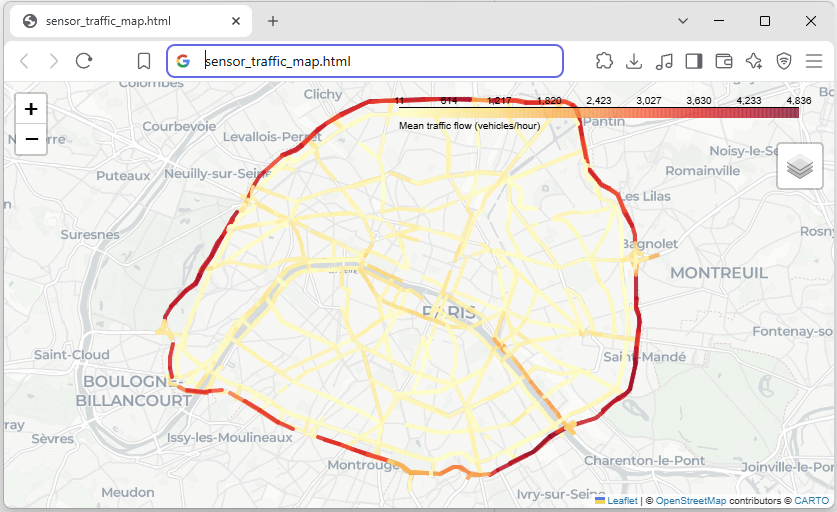

# OpenMobility 🚦

**Open-source, CPU-first urban mobility intelligence for Paris.**

OpenMobility is a Python-based urban mobility data engineering and predictive analytics project focused on understanding and anticipating traffic patterns across Paris.

The project combines public traffic measurements, data quality assessment, exploratory analysis, geographic information, machine learning, and anomaly detection to build an extensible foundation for urban mobility intelligence.

Starting with permanent road traffic counters published by the City of Paris, OpenMobility provides a reproducible pipeline to collect, process, analyze, visualize, and forecast traffic conditions.

The long-term objective is to extend this foundation toward road-network intelligence, spatial-temporal modeling, and explainable mobility insights.



Some prediction forecasting done by a simple XGboost model on 4 days of data:


---

## Project overview

OpenMobility is developed incrementally through four phases:

| Phase | Focus | Status |
|---|---|---|
| Phase 1 | Data engineering and exploratory analysis | Completed |
| Phase 2 | Predictive analytics and anomaly detection | Completed |
| Phase 3 | Road-network intelligence | Planned |
| Phase 4 | Mobility intelligence platform | Planned |

The current implementation provides a complete workflow from raw traffic data ingestion to sensor-level forecasting and predictive evaluation.

## Features

### 1. Data ingestion

- Retrieve traffic measurements from the Paris Open Data API.
- Paginated downloads with configurable record limits.
- Store raw records in JSON Lines (JSONL) format.
- Save download metadata for reproducibility.

### 2. Data inspection and preprocessing

- Inspect source schemas, inferred data types, and sample records.
- Identify relevant source columns using configurable candidate field names.
- Normalize traffic measurements into a consistent analytical schema.
- Convert timestamps to timezone-aware datetime values.
- Store normalized datasets in compressed Parquet format.

### 3. Data quality assessment

- Calculate missing-value counts and percentages.
- Identify duplicate sensor/timestamp combinations.
- Assess sensor coverage.
- Calculate descriptive statistics for traffic flow and occupancy.
- Examine traffic-state distributions.

### 4. Exploratory data analysis

- Analyze traffic flow by hour of day.
- Compare traffic patterns across weekdays.
- Evaluate missing measurements by sensor.
- Calculate hourly sensor measurement availability.
- Generate analytical CSV outputs and visualizations.

### 5. Geographic integration

- Retrieve the Paris road-network geographic reference.
- Associate traffic sensors with geographic road segments.
- Aggregate measurements at sensor level.
- Calculate geographic matching statistics.
- Export the resulting geographic dataset to Parquet.

### 6. Interactive traffic visualization

- Generate interactive maps using Folium.
- Visualize road segments according to average traffic flow.
- Display traffic statistics through interactive tooltips.
- Use CARTO basemaps with API-key authentication.
- Export standalone HTML maps.

### 7. Traffic forecasting

- Train individual XGBoost regression models for eligible traffic sensors.
- Use historical traffic measurements and temporal features.
- Incorporate lagged traffic measurements and rolling statistics.
- Include cyclical hour-of-day and day-of-week features.
- Incorporate lagged occupancy information when available.
- Perform chronological training and holdout evaluation.
- Generate configurable multi-hour traffic forecasts.
- Save trained models for individual sensors.

### 8. Predictive evaluation

- Compare XGBoost predictions against a seasonal-naive baseline.
- Calculate Mean Absolute Error (MAE).
- Calculate Root Mean Squared Error (RMSE).
- Calculate Mean Absolute Percentage Error (MAPE).
- Calculate the coefficient of determination (R²) during evaluation.
- Generate sensor-level and aggregate evaluation metrics.
- Visualize actual versus predicted traffic.
- Analyze residual distributions and prediction errors.
- Compare model performance across sensors.

### 9. Traffic anomaly detection

- Analyze prediction residuals on the chronological holdout dataset.
- Calculate robust residual scores using rolling medians and median absolute deviations.
- Identify unusually large traffic deviations.
- Distinguish potential traffic spikes from traffic drops.
- Export detected anomalies for further investigation.

---

## Technology stack

| Technology | Purpose |
|---|---|
| Python 3.11+ | Core development |
| Polars | Data processing and transformations |
| PyArrow | Parquet interoperability |
| Pandas | Machine learning data preparation |
| NumPy | Numerical operations |
| GeoPandas | Geographic data processing |
| Shapely | Geometric operations |
| Folium | Interactive geographic visualization |
| Matplotlib | Exploratory charts and evaluation plots |
| XGBoost | Traffic forecasting |
| Scikit-learn | Machine learning utilities |
| Typer | Command-line interface |
| Rich | Terminal output |
| Requests | API communication |
| tqdm | Progress monitoring |
| pytest | Automated testing |

The project follows a CPU-first approach. The current forecasting implementation uses XGBoost with histogram-based tree construction and does not require GPU infrastructure.

---

## Data sources

### Paris permanent road traffic counters

**Dataset:** Comptage routier – Données trafic issues des capteurs permanents

- Publisher: Ville de Paris, Direction de la Voirie et des Déplacements.
- Dataset identifier: `comptages-routiers-permanents`.
- Temporal resolution: Hourly.
- Coverage: Rolling 13-month dataset.
- License: Open Database License (ODbL).

**Resources:**

- [Paris Open Data dataset](https://opendata.paris.fr/explore/dataset/comptages-routiers-permanents/)
- [Paris Open Data API](https://opendata.paris.fr/api/explore/v2.1/catalog/datasets/comptages-routiers-permanents/records)

The dataset provides measurements from permanent traffic sensors, including:

- Traffic flow (vehicles per hour).
- Occupancy rate (percentage of the measurement interval during which vehicles are present).
- Traffic-state information, when available.

Traffic flow and occupancy should be interpreted together when assessing congestion.

### Geographic reference

The project also uses the Paris road-network geographic reference:

- Dataset identifier: `referentiel-comptages-routiers`.
- Source: Paris Open Data.
- Format: GeoJSON.
- Geographic reference field: `iu_ac`.

The geographic reference is used to associate traffic measurements with road geometries.

For additional information about data provenance and licensing, see [docs/data_sources.md](docs/data_sources.md).

---

## Installation

### Requirements

- Python 3.11 or newer.
- Git.
- Internet connection for downloading public datasets.

### 1. Clone the repository

```bash
git clone https://github.com/spenam/OpenMobility.git
cd OpenMobility
```

### 2. Create a virtual environment

**Windows PowerShell:**

```powershell
python -m venv .venv
.venv\Scripts\Activate.ps1
```

**macOS / Linux:**

```bash
python -m venv .venv
source .venv/bin/activate
```

### 3. Install dependencies

Upgrade pip:

```bash
python -m pip install --upgrade pip
```

Install the project with development, geographic, and machine learning dependencies:

```bash
pip install -e ".[dev,geo,ml]"
```

This installs the core dependencies, testing and development tools, geographic visualization libraries, and machine learning libraries.

---

## Usage

OpenMobility provides a command-line interface for the complete data workflow.

### Phase 1 — Data engineering and exploratory analysis

#### Step 1: Download traffic data

Retrieve a sample of 5,000 records:

```bash
openmobility fetch
```

Specify a custom download limit:

```bash
openmobility fetch --max-records 20000 --page-size 100
```

Raw records are stored in:

```text
data/raw/paris_traffic.jsonl
```

Download metadata is also generated alongside the raw dataset.

#### Step 2: Inspect the source data

```bash
openmobility inspect
```

This command displays:

- Number of records.
- Available source columns.
- Inferred data types.
- Sample records.

Schema inspection is important because the Paris Open Data API may evolve over time.

#### Step 3: Preprocess the data

```bash
openmobility preprocess
```

The preprocessing pipeline:

- Identifies relevant timestamp and sensor columns.
- Detects available traffic measurements.
- Normalizes the source fields.
- Converts timestamps into timezone-aware UTC values.
- Removes records without valid timestamps or sensor identifiers.
- Saves the normalized dataset in Parquet format.

Output:

```text
data/processed/paris_traffic_normalized.parquet
```

If a source field cannot be confidently identified, the pipeline reports the available columns so candidate mappings can be updated.

#### Step 4: Assess data quality

```bash
openmobility quality
```

Generates a data-quality report containing:

- Total observations.
- Number of unique sensors.
- Temporal coverage.
- Duplicate sensor/timestamp combinations.
- Missing-value statistics.
- Traffic measurement statistics.
- Traffic-state distribution.

#### Step 5: Perform exploratory analysis

```bash
openmobility explore
```

This command generates exploratory summaries and charts from the normalized dataset.

The analysis includes:

**Traffic flow by hour**

Average and median traffic flow across the 24 hours of the day.

**Traffic flow by weekday**

Comparison of traffic patterns across the seven days of the week.

**Missing measurements by sensor**

Assessment of missing flow and occupancy measurements for individual sensors.

**Hourly sensor availability**

A sensor-hour completeness matrix showing whether both traffic flow and occupancy measurements are available.

Generated outputs:

```text
reports/
└── eda/
    ├── traffic_flow_by_hour.csv
    ├── traffic_flow_by_weekday.csv
    ├── missing_values_by_sensor.csv
    ├── sensor_hour_availability.csv
    └── charts/
        ├── traffic_flow_by_hour.png
        ├── traffic_flow_by_weekday.png
        └── sensor_availability.png
```

A custom output directory can also be specified:

```bash
openmobility explore reports/custom_eda
```

#### Step 6: Retrieve geographic reference data

```bash
openmobility fetch-geography
```

Downloads the Paris road-network geographic reference in GeoJSON format.

Output:

```text
data/raw/paris_sensor_geography.geojson
```

#### Step 7: Associate traffic data with road geometry

```bash
openmobility map-traffic
```

This command:

1. Reads the geographic reference.
2. Loads normalized traffic measurements.
3. Aggregates traffic statistics by sensor.
4. Matches sensor identifiers with geographic road segments.
5. Calculates geographic matching statistics.
6. Saves the resulting geographic dataset.

Output:

```text
data/processed/paris_sensor_geography.parquet
```

The command also reports the number of matched and unmatched road segments and the matching percentage.

#### Step 8: Generate the interactive traffic map

The `map-traffic` command also generates an interactive Folium map after successfully building the geographic dataset.

The map displays:

- Road segments colored according to mean traffic flow.
- Interactive tooltips with sensor and traffic statistics.
- A traffic intensity color scale.
- An interactive layer control.
- A CARTO basemap.

Output:

```text
reports/eda/sensor_traffic_map.html
```

Open the generated HTML file in a web browser to explore the map.

---

### Phase 2 — Predictive analytics

Phase 2 introduces machine learning capabilities on top of the normalized traffic dataset.

The objective is to move from descriptive traffic analysis toward forecasting and the identification of unusual traffic behavior.

#### Step 9: Train forecasting models and detect anomalies

Run the predictive analytics pipeline:

```bash
openmobility predict
```

The command trains XGBoost models for eligible sensors, evaluates predictions on a chronological holdout period, generates future forecasts, and identifies anomalous traffic observations.

Optional parameters:

```bash
openmobility predict --horizon 48
```

Generate a 48-hour forecast instead of the default 24-hour horizon.

```bash
openmobility predict --min-sensor-rows 100
```

Change the minimum number of valid hourly observations required for sensor eligibility.

```bash
openmobility predict --verbose
```

Display a detailed predictive analytics summary.

The default configuration uses:

| Parameter | Default |
|---|---:|
| Forecast horizon | 24 hours |
| Minimum sensor history | 40 valid hours |
| Training split | 80% |
| Holdout split | 20% |
| XGBoost estimators | 250 |
| Maximum tree depth | 4 |
| Learning rate | 0.05 |
| Random seed | 42 |

The model configuration is defined in the predictive analytics implementation.

#### Forecasting methodology

OpenMobility trains one XGBoost regression model per eligible traffic sensor.

The models use historical traffic information and temporal features to estimate future traffic flow.

The main features include:

**Historical traffic information**

- Previous-hour traffic flow (`lag_1`).
- Traffic flow from the previous day (`lag_24`).
- Rolling 24-hour mean traffic flow.

**Temporal features**

- Hour of day.
- Day of week.
- Weekend indicator.
- Cyclical encoding of the hour.
- Cyclical encoding of the day of the week.

**Additional measurement**

- Previous-hour occupancy, when available.

The normalized timestamps are converted to the `Europe/Paris` timezone before feature engineering, ensuring that temporal features reflect local traffic patterns.

#### Model training and validation

To avoid random mixing of historical and future observations, the dataset is divided chronologically.

- First 80%: Model training.
- Remaining 20%: Holdout evaluation.

This provides a more realistic approximation of how the forecasting system would perform when predicting future traffic using historical observations.

A seasonal-naive baseline based on the previous day's traffic measurement (`lag_24`) is also evaluated.

The baseline provides a simple reference against which the machine learning model can be compared.

#### Future traffic forecasting

After holdout evaluation, each sensor model is retrained using its available modeling history.

The trained model is then used recursively to generate the next traffic observations.

Each prediction becomes part of the input history for subsequent forecast steps.

The default output covers the next 24 hours, although the forecasting horizon can be configured through the CLI.

#### Anomaly detection

Traffic anomalies are identified through prediction residuals:

```text
residual = actual_flow - predicted_flow
```

A robust statistical approach based on rolling medians and median absolute deviations is used to calculate anomaly scores.

Observations with an absolute robust score greater than or equal to 3.5 are flagged as anomalies.

The implementation distinguishes between:

- `traffic_spike`: Actual traffic is substantially higher than predicted.
- `traffic_drop`: Actual traffic is substantially lower than predicted.

These detections represent unusual deviations from expected traffic behavior, not necessarily confirmed incidents.

#### Generated forecasting outputs

The predictive analytics pipeline generates:

```text
reports/
└── forecasting/
    ├── summary.json
    ├── model_metrics.csv
    ├── model_metrics.parquet
    ├── holdout_predictions.csv
    ├── holdout_predictions.parquet
    ├── next_24h_forecasts.csv
    ├── next_24h_forecasts.parquet
    ├── traffic_anomalies.csv
    ├── traffic_anomalies.parquet
    └── models/
        ├── sensor_<id>.json
        └── ...
```

The output includes:

- Model performance metrics.
- Actual and predicted holdout traffic.
- Seasonal-naive baseline predictions.
- Future traffic forecasts.
- Detected anomalies.
- Serialized XGBoost models for individual sensors.

#### Step 10: Evaluate predictive performance

After generating predictions, run:

```bash
openmobility evaluate
```

This command evaluates the saved holdout predictions and compares XGBoost performance against the seasonal-naive baseline.

The evaluation includes:

**Regression metrics**

- Mean Absolute Error (MAE).
- Root Mean Squared Error (RMSE).
- Coefficient of determination (R²).

**Visual analysis**

- Actual versus predicted traffic.
- Prediction residual distribution.
- Residuals versus predicted traffic.
- Sensor-level MAE comparison between XGBoost and the baseline.

Generated outputs:

```text
reports/
└── evaluation/
    ├── evaluation_metrics.csv
    ├── evaluation_summary.json
    ├── residual_distribution.png
    ├── residuals_vs_prediction.png
    ├── sensor_mae_comparison.png
    └── sensor_<id>_forecast.png
```

The evaluation command uses the holdout predictions generated by the predictive analytics pipeline.

The metrics should be interpreted together: MAE measures average absolute prediction error, RMSE penalizes larger errors, and R² measures explained variance.

---

## CARTO configuration

OpenMobility supports CARTO basemaps for interactive traffic visualization.

To use CARTO, obtain an API key from [CARTO](https://carto.com/) and configure it as an environment variable.

Create a `.env` file in the project root:

```env
CARTO_API_KEY=your_carto_api_key
```

The application loads this variable when generating the interactive map.

**Security:** Do not commit your `.env` file or expose your API key in public repositories. Since browser-based tile requests require the key to be sent to the client, configure appropriate usage restrictions and quotas in your CARTO account.

---

## Project structure

```text
OpenMobility/
│
├── configs/
│   └── data.yaml
│
├── data/
│   ├── raw/
│   ├── interim/
│   └── processed/
│
├── docs/
│   └── data_sources.md
│
├── reports/
│   ├── eda/
│   │   ├── charts/
│   │   └── sensor_traffic_map.html
│   │
│   ├── forecasting/
│   │   └── models/
│   │
│   └── evaluation/
│
├── src/
│   └── openmobility/
│       │
│       ├── ingestion/
│       │   ├── paris_traffic.py
│       │   └── paris_geography.py
│       │
│       ├── processing/
│       │   ├── normalize.py
│       │   ├── quality.py
│       │   ├── exploratory.py
│       │   ├── geography.py
│       │   ├── predictive.py
│       │   └── evaluation.py
│       │
│       ├── visualization/
│       │   ├── traffic.py
│       │   └── maps.py
│       │
│       └── cli.py
│
├── tests/
│   ├── test_ingestion.py
│   ├── test_normalize.py
│   ├── test_exploratory.py
│   └── test_predictive.py
│
├── .github/
│   └── workflows/
│
├── .env.example
├── .gitignore
├── Makefile
├── pyproject.toml
└── README.md
```

Generated datasets, model artifacts, and reports are stored locally and should not be committed to the repository unless explicitly intended.

---

## Normalized data model

The preprocessing pipeline produces a consistent analytical dataset.

| Column | Description |
|---|---|
| `timestamp` | Time of the observation, normalized to UTC |
| `sensor_id` | Traffic sensor identifier |
| `flow_vehicles_per_hour` | Hourly vehicle count |
| `occupancy_pct` | Occupancy rate |
| `traffic_state` | Traffic-state label, when available |

Not all source records necessarily contain every measurement.

The exploratory analysis and predictive pipeline convert timestamps to the `Europe/Paris` timezone when examining local traffic patterns.

---

## Engineering principles

OpenMobility follows several design principles:

- **Reproducibility:** Raw source records and download metadata are retained.
- **Data provenance:** Public data sources and licensing are documented.
- **CPU-first development:** Current workflows do not require GPU infrastructure.
- **Columnar processing:** Polars and Parquet are used for efficient analytical workflows.
- **Explicit data validation:** Unrecognized source fields should be investigated rather than silently guessed.
- **Modularity:** Ingestion, processing, geographic integration, forecasting, and visualization are separated into dedicated modules.
- **Chronological evaluation:** Predictive models are evaluated using time-ordered holdout observations.
- **Baseline comparison:** Machine learning performance is compared against a simple forecasting reference.
- **Incremental development:** Advanced modeling builds on reliable data engineering foundations.

---

## Roadmap

The project is being developed incrementally.

### Phase 1 — Data engineering and exploratory analysis

- [x] Paris traffic data ingestion.
- [x] Schema inspection and normalization.
- [x] Parquet-based storage.
- [x] Data-quality reporting.
- [x] Exploratory traffic analysis.
- [x] Sensor availability analysis.
- [x] Geographic reference ingestion.
- [x] Traffic-to-road geographic integration.
- [x] Interactive traffic visualization.

### Phase 2 — Predictive analytics

- [x] Sensor-level XGBoost forecasting.
- [x] Temporal and historical feature engineering.
- [x] Chronological training and holdout evaluation.
- [x] Seasonal-naive forecasting baseline.
- [x] Configurable multi-hour traffic forecasting.
- [x] Model performance metrics.
- [x] Prediction residual analysis.
- [x] Traffic anomaly detection.
- [x] Export of forecasts, predictions, anomalies, and trained models.

### Phase 3 — Road-network intelligence

- [ ] Road-network graph construction.
- [ ] Spatial and temporal feature engineering.
- [ ] CPU-feasible graph neural network experiments.
- [ ] Network-level traffic analysis.
- [ ] Traffic propagation and neighboring-sensor analysis.
- [ ] Spatially informed forecasting.

### Phase 4 — Mobility intelligence platform

- [ ] FastAPI service.
- [ ] Interactive analytical dashboard.
- [ ] Experiment tracking.
- [ ] Explainable mobility insights.
- [ ] Evidence-grounded mobility intelligence agent.
- [ ] Integration of forecasting and network-level intelligence.

---

## Limitations and considerations

- Traffic measurements are available only at equipped sensor locations.
- Sensor coverage is not spatially uniform across Paris.
- Geographic matching depends on consistency between sensor identifiers and geographic reference identifiers.
- Missing measurements should be preserved and explicitly considered during analysis.
- Traffic flow alone is insufficient to characterize congestion.
- The current traffic dataset is a rolling 13-month dataset; historical data is available separately.
- Forecasting performance depends on the quantity and quality of historical observations available for each sensor.
- Sensors with insufficient history are excluded from predictive modeling.
- Recursive multi-hour forecasts can accumulate prediction errors as the horizon increases.
- The seasonal-naive baseline is a simple reference, not a complete representation of traffic seasonality.
- Detected anomalies indicate statistical deviations from model expectations and should not automatically be interpreted as real-world incidents.
- Geographic matching statistics should be monitored when source datasets are updated.

---

## License and attribution

OpenMobility is distributed under the MIT License.

The underlying Paris Open Data datasets have their own licensing requirements, including ODbL obligations.

Users should review the original data-source terms and preserve the required attribution when redistributing datasets or derived products.

See [docs/data_sources.md](docs/data_sources.md) for data provenance and source references.

---

## Contributing

Contributions, suggestions, and improvements are welcome.

Potential areas for contribution include:

- Data ingestion and validation.
- Geographic matching improvements.
- Exploratory traffic analysis.
- Forecasting model improvements.
- Anomaly detection.
- Road-network modeling.
- Spatial-temporal machine learning.
- Documentation and testing.

Please open an issue to discuss significant changes before submitting a pull request.

---

**OpenMobility — Building an open foundation for urban mobility intelligence.**